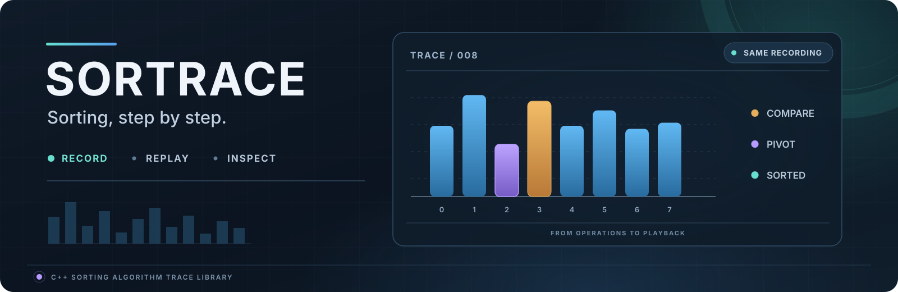
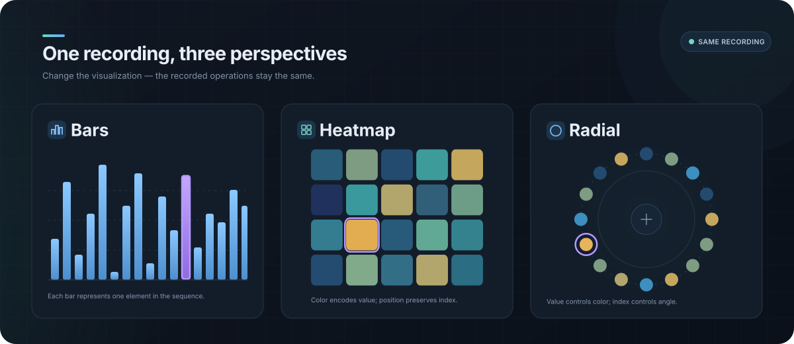

<p align="center">
  
</p>

<div align="center">

[](https://isocpp.org/)
[](https://cmake.org/)
[](https://github.com/DMsuDev/sortrace/actions/workflows/ci.yml)


[](LICENSE)

</div>

[Installation](#installation)
• [Quick Start](#quick-start)
• [Algorithms](#built-in-algorithms)
• [Examples](#examples)
• [Documentation](#documentation)

---

**Sortrace** is a header-only C++23 library that records a sorting algorithm once and lets you replay that run, forwards or backwards, as many times as you like. Every comparison, swap, write and mark is captured in a standalone `Recording<T>` that holds everything needed to reproduce the run, so the algorithm never has to execute again.

<div align="center">
  
  <p><em>One recording, many ways to explore it.</em></p>
</div>

What you build on top is up to you: bars, a heatmap, a terminal display, sound effects or an export format. Sortrace captures and replays; it never decides how a run should look or sound.

- **Reversible:** every operation keeps the values it touched, so playback runs backwards without re-running the algorithm.
- **Marks:** named marks (pivot, minimum, or your own) follow elements through swaps in both directions. See [Marks](docs/MARKS.md).
- **Consistent statistics:** comparisons, swaps, reads, writes and compute time are counted the same way for every algorithm.
- **UI friendly:** a `Session` computes in approximate time slices and resumes where it stopped.
- **Generic:** works with `int`, `std::string` and your own types. Errors are `std::expected` values, and logging goes through a callback.

## Installation

Sortrace is header-only. It needs a C++23 compiler and CMake 3.23 or newer:

```cmake
add_subdirectory(third_party/sortrace)
target_link_libraries(my_app PRIVATE sortrace::sortrace)
```

`FetchContent`, `find_package`, plain headers, and building the tests and examples are covered in the [installation guide](docs/INSTALL.md).

## Quick Start

A Sortrace application has two phases: **record** a run, then **replay** it. Recording does not draw anything, and replaying does not sort anything. Choose between two execution modes to compute the recording:

| Mode            | API                        | When to use it                                                                        |
| :-------------- | :------------------------- | :------------------------------------------------------------------------------------ |
| **Blocking**    | `record()`                 | Runs to completion in one call; useful for CLI tools and tests.                       |
| **Incremental** | `Session::compute(budget)` | Resumes across calls with an approximate time budget; useful for UIs and comparisons. |

Both produce a recording for playback. Incremental computation still runs on the calling thread, and a call can exceed its budget. See [Execution](docs/ARCHITECTURE.md#execution) for details.

<details>
<summary><strong>Blocking: record and replay a complete run</strong></summary>

Run an algorithm once, then step through its recording whenever you need to render a frame:

```cpp
#include <sortrace/sortrace.hpp>

using namespace sortrace;

// 1. Record: run an algorithm to completion over your data.
std::vector<int> data = { 5, 2, 9, 1, 7 };
auto recording = record<int>(AlgorithmType::QuickSort, data);

// 2. Replay: step through it in any direction, whenever you want.
Playback<int> playback;
if (playback.load(std::move(recording))) {
    while (playback.stepForward()) {
        draw(playback.getData(), playback.getMarks(), playback.getCurrentOperation());
    }
}
```

</details>

<details>
<summary><strong>Incremental: compute in a UI</strong></summary>

Use a `Session` to spread sorting work across frames:

```cpp
std::vector<int> data = { 5, 2, 9, 1, 7 };
Playback<int> playback;

Session<int> session;
session.setAlgorithm(make<int>(AlgorithmType::MergeSort));
session.setData(data);

// Once per frame, until it completes or reports an error.
auto progress = session.compute(std::chrono::microseconds{ 2500 });
if (!progress)
    onComputeError(progress.error());
else if (*progress == Progress::Complete)
{
    auto loaded = playback.load(session.getRecording());
    if (!loaded)
        onPlaybackError(loaded.error());
    else
        playback.play();
}
```

`onComputeError` and `onPlaybackError` stand for your application's error reporting.

</details>

<br>

> Everything a renderer reads (data, marks, the next operation, settled slots) is listed in [Architecture](docs/ARCHITECTURE.md#recording-and-playback).

## Built-in algorithms

Sortrace includes algorithms such as Bubble, Quick, Merge and Heap Sort. The complete list, with average complexity and descriptions, lives in the [algorithm registry](include/sortrace/algorithms/registry.hpp). All built-in algorithms run through the same test suite.

Use `sortrace::algorithms()` to enumerate the registry in your application. You can also [add your own algorithms](docs/EXTENDING.md#add-a-sorting-algorithm).

## Examples

Everything runs in the terminal with just Sortrace and the standard library.

**`sortrace_cli`** is an interactive tour: record an algorithm, replay it, step through it, run a `Session` and compare algorithms. Type `tour` for a guided walk-through or `help` to see every command.

```bash
./build/bin/sortrace_cli
```

Eight smaller programs each focus on one idea: recording, sessions, playback, marks, shared views and JSON export. See the [examples guide](examples/README.md).

## Documentation

- [Installation](docs/INSTALL.md): add Sortrace to a project, build the tests and examples, CMake options.
- [Architecture](docs/ARCHITECTURE.md): the recording pipeline, execution modes, statistics and guarantees.
- [Marks](docs/MARKS.md): tracking elements through a run.
- [Extending](docs/EXTENDING.md): add an algorithm or build a renderer.
- [Examples](examples/README.md): the interactive CLI and the small programs.

## Contributing

Contributions are always welcome! ❤️ Whether you are reporting bugs, fixing issues, adding algorithms or improving the documentation, your help is appreciated.

Before opening a pull request:

- Keep pull requests focused: prefer small, atomic PRs that address a single feature or fix.
- Add or update tests; every registered algorithm is covered by the shared suite automatically.
- Ensure the project builds cleanly without new warnings (`-DSORTRACE_STRICT_WARNINGS=ON`).

For major changes or new features, please open an issue first to discuss what you would like to change.

## License

This project is licensed under the **MIT License**. <br>
See the [LICENSE](LICENSE) file for details.
