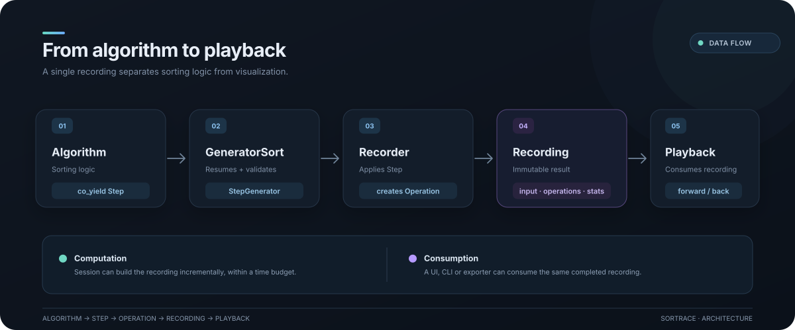
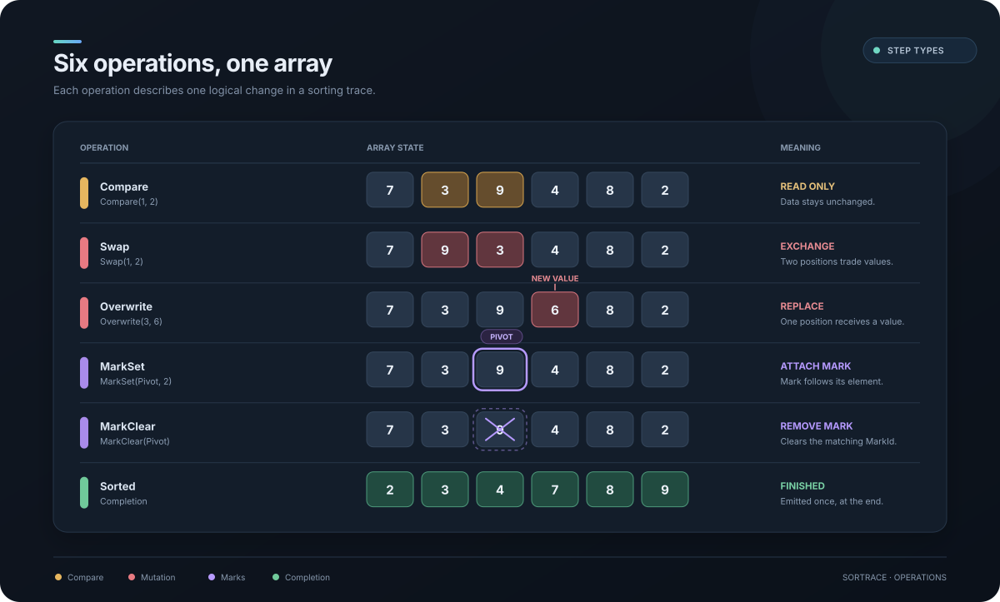
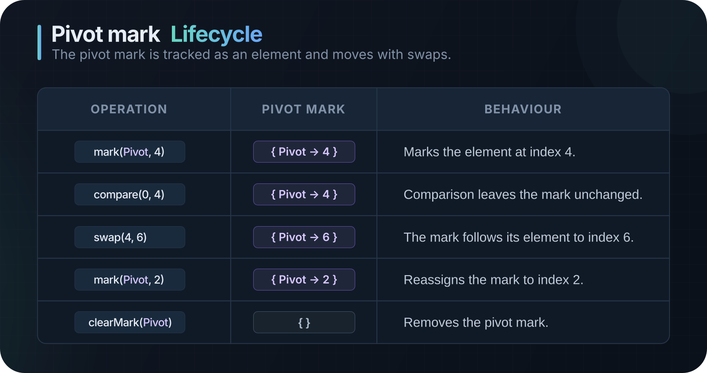
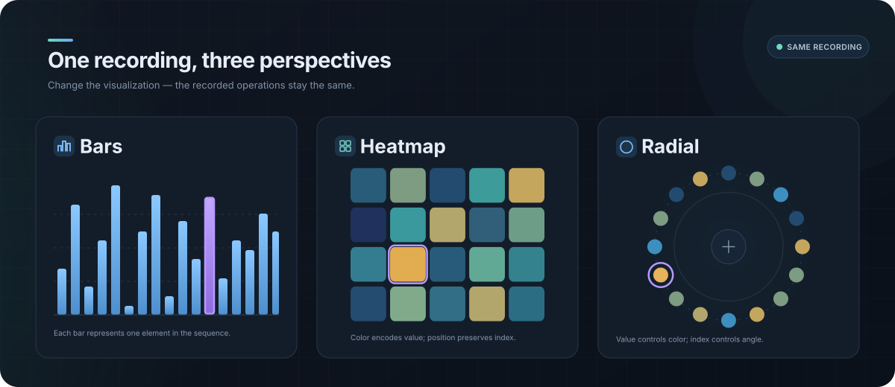

# Architecture

`sortrace` separates **computing** a sort from **showing** it. This page walks through the pipeline, the guarantees, and the freedom a recording gives its renderer.

- [Architecture](#architecture)
  - [The pipeline](#the-pipeline)
  - [Operations](#operations)
  - [Marks](#marks)
  - [Recording and Playback](#recording-and-playback)
  - [Execution](#execution)
  - [One recording, many possibilities](#one-recording-many-possibilities)
  - [Guarantees](#guarantees)
  - [Errors and logging](#errors-and-logging)

## The pipeline

<div align="center">
  
</div>

1. An **algorithm** is a coroutine that only _describes_ what it wants: `co_yield Step::swap(i, j)`.
2. **GeneratorSort** validates the step and applies it through the **Recorder**.
3. The **Recorder** edits the working buffer, updates the statistics and returns an `Operation`.
4. The operations, the initial data and the statistics form a **Recording**.
5. A **Playback** replays it over its own copy of the data, forward and backward.

The algorithm never runs while you watch. That is what makes stepping backward, scrubbing and comparing several algorithms on identical data cheap.

## Operations

<div align="center">
  
</div>

An operation records one event in the run:

- **`Compare`** reads two slots (`indexA`, `indexB`) and stores both values. It does not change the data.
- **`Swap`** exchanges two slots and stores their values from before the exchange.
- **`Overwrite`** writes a value to `indexA`; `valueA` is the new value and `valueB` is the value it replaced.
- **`MarkSet`** points a mark at `indexA` and stores the value there. **`MarkClear`** removes that mark.
- **`Sorted`** signals the end of the run.

Fields that do not apply to an operation use `-1` for indices and a default value for values. Mark operations carry a `MarkId`. Because operations retain the values they touch, playback can undo each operation in O(1).

## Marks

<div align="center">
  
</div>

A mark is an optional annotation: it says that an element has a particular meaning to the algorithm right now. It is attached to the **element**, so its index follows that element through swaps, forward and backward.

The library names a few common roles (`Pivot`, `Minimum`, `Root`, `Active`) and lets you define custom IDs with `MarkId::custom_id(id)`. They are conventions, not rules: an algorithm can use no marks, and a renderer can ignore them. Several marks can point to the same element, while each ID points to at most one element at a time. See [Marks](MARKS.md) for the roles and their lifecycle.
A mark's visual appearance is entirely up to the renderer. The same mark could be a colored bar, a ring, a label, or something else; `sortrace` does not prescribe a style.

## Recording and Playback

A `Recording<T>` holds the algorithm name, the original input, the ordered operations, and the run's statistics. `record()` returns a recording by value, which the caller owns. For sharing, `recordShared()` and a completed `Session` provide a `std::shared_ptr<const Recording<T>>`; the `const` handle prevents changes to the recorded run.

`Playback::load()` accepts either that shared pointer or a recording by value, for example `playback.load(record<int>(type, data))`. Each playback keeps its own position, visible data, and marks. So several playbacks can share one recording while advancing independently:

```cpp
auto run = recordShared<int>(AlgorithmType::QuickSort, data);

Playback<int> bars, heatmap;
const auto barsLoaded = bars.load(run);
const auto heatmapLoaded = heatmap.load(run);
if (!barsLoaded || !heatmapLoaded)
    return; // Handle the PlaybackError in your application.
```

A runnable version is [shared_views](../examples/basic/shared_views.cpp).

`Playback<T>` exposes the current state and the information needed to render it:

- **Current data:** `getData()`
- **Current event:** `getCurrentOperation()`
- **Marks:** `getMarks()`, `getMarkIndex(id)`
- **Settled slots:** `isSettled(slot)`
- **Progress:** `getProgress()`, `getCurrentOperationIndex()`

Time is optional. A CLI calls `stepForward()` in a loop. A UI calls `update(deltaSeconds)` each frame, with `setDelayMs()` for the speed and `enableDelay(false)` to finish instantly.

States: `Stopped` (first operation, data untouched), `Playing`, `Paused`, `Finished`. `play()` starts from Stopped, resumes from Paused and restarts from Finished.

## Execution

Both `record()` and `Session<T>` execute an algorithm and produce a `Recording<T>`. Choose based on whether running the algorithm should block the caller:

**Use `record()`** for CLI tools, tests, or other cases where running to completion in one call is appropriate.

**Use `Session<T>`** when execution needs to stay responsive, such as in a UI or when comparing runs. It computes in time slices and resumes between calls:

```cpp
auto progress = session.compute(std::chrono::microseconds{ 2500 }); // call again while InProgress
```

See [session_budget](../examples/basic/session_budget.cpp) for the full loop.

- A budget limits work approximately: elapsed time is checked every 256 algorithm steps, so a call can overshoot. A zero budget runs to completion and is refused above `SessionOptions::blockingLimit`, because O(n²) algorithms can produce millions of operations.
- Each session keeps its own run state, so many sessions can run side by side (comparison views).
- `getSessionId()` gives each session a stable, unique identity.
- When complete, `getRecording()` hands out the shared recording. A `Session` knows nothing about playback.

## One recording, many possibilities

<div align="center">
  
</div>

The library speaks about **positions in a linear array**, **values**, and recorded operations. It does not provide or restrict renderers. For example, a renderer might map:

- **Bars:** position to horizontal location, value to height, and marks to color.
- **Heatmap:** position to a cell, value to a color, and marks to a border.
- **Circle:** position to an angle, value to color or radius, and marks to a ring.
- **Terminal:** position to a column, value to text, and marks to an arrow.

> [!IMPORTANT]
> These are only examples—not built-in modes, an exhaustive list, or requirements. `sortrace` puts no limit on how an application chooses to represent a recording.

A renderer can create a different layout, sound, export, or any other representation that fits its application. It also decides whether and how to show marks.

To animate only what changed, use `getCurrentOperation()`: it names the indices and values involved, so a renderer never has to diff whole arrays.

## Guarantees

- **Replay is exact.** Playing a recording forward reproduces the algorithm's result; stepping all the way back restores the input.
- **Statistics cannot lie.** The Recorder builds each operation from the real buffer and counts as a byproduct. Algorithms cannot hand-write operations.
- **One `Sorted`, always last**, also for empty and one-element input.
- **Indices are validated** at the boundary: when an algorithm yields a step, and again when a recording is loaded. Replaying needs no per-step checks.
- **Settled means final.** `isSettled(slot)` is true only once no remaining operation changes that slot.
- **Recordings are values.** Nothing in a recording points into a session or an algorithm.

## Errors and logging

Expected failures are returned as values rather than thrown as exceptions:

- `Session::compute()` returns `std::expected<Progress, ComputeError>`.
- `Playback::load()` returns `std::expected<void, PlaybackError>`.

`ComputeError` can be `NoAlgorithm`, `NoData`, `TooLargeForBlocking`, or `AlgorithmThrew`. `PlaybackError` can be `EmptyRecording` or `InvalidOperation`.

The library is **silent by default** and never asserts on missing setup. To see its diagnostics, give any `Session` or `Playback` a sink:

```cpp
session.setLogSink([](sortrace::LogLevel level, std::string_view message) {
    my_logger.write(level, message); // spdlog, stderr... your choice.
});
```

Messages are formatted only when a sink is set.
