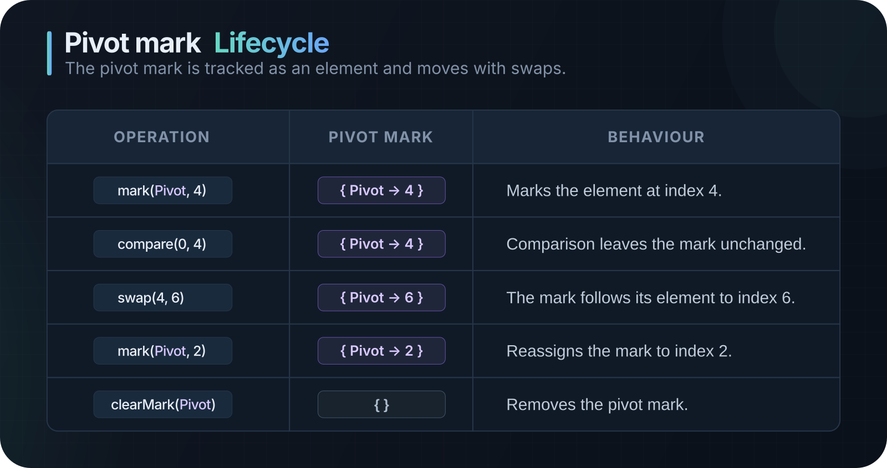

# Marks

_Name an element. Follow it through the run._

A **mark** is an optional label that an algorithm attaches to an element while that element means something: the pivot of a partition, the smallest value found so far, the end of a range. Marks never change the data or the sort. They exist so a renderer can answer one question: _"which elements is the algorithm paying attention to right now?"_

- [Marks](#marks)
  - [The idea in 60 seconds](#the-idea-in-60-seconds)
  - [Anatomy of a mark](#anatomy-of-a-mark)
    - [Roles](#roles)
    - [Identity](#identity)
  - [Lifecycle](#lifecycle)
  - [Emitting marks from an algorithm](#emitting-marks-from-an-algorithm)
  - [Custom marks](#custom-marks)
    - [1. Give your ids names](#1-give-your-ids-names)
    - [2. Emit them from the algorithm](#2-emit-them-from-the-algorithm)
    - [3. Style them in the renderer](#3-style-them-in-the-renderer)
  - [Reading marks in a renderer](#reading-marks-in-a-renderer)
  - [Behavior reference](#behavior-reference)

## The idea in 60 seconds

```cpp
co_yield S::mark(MarkRole::Pivot, high);   // 1. the algorithm points a mark at an element
// ... partition around it ...
co_yield S::clearMark(MarkRole::Pivot);    // 2. and removes it when it stops mattering
```

```cpp
for (const auto& [id, index] : playback.getMarks())   // 3. the renderer reads what is marked now
    highlight(index, styleFor(id));
```

That is the whole contract. The library **records** marks and keeps them correct while you step forward and backward. It never decides what they look like.

> [!NOTE]
> Marks are entirely optional. An algorithm may emit none, and a renderer may ignore every one it receives.

## Anatomy of a mark

A mark is identified by a `MarkId` and points at one element at a time:

```cpp
struct MarkId
{
    MarkRole      role   = MarkRole::Pivot;
    std::uint32_t custom = 0;   // only meaningful when role == MarkRole::Custom
};
```

### Roles

`MarkRole` offers a few names for common situations, plus an escape hatch for everything else.

| Role      | Intended meaning                             | Used by the built-in algorithms |
| :-------- | :------------------------------------------- | :------------------------------ |
| `Pivot`   | The element a partition is built around.     | Quick Sort                      |
| `Minimum` | The smallest element found so far.           | Selection Sort                  |
| `Root`    | A heap root being sifted.                    | —                               |
| `Active`  | The element currently being worked on.       | —                               |
| `Custom`  | Anything you define, told apart by a number. | —                               |

> [!IMPORTANT]
> The names describe _intent_, not behavior. `Pivot` does not make an algorithm use a pivot, and an algorithm is free to use `Root` for something unrelated to heaps. Treat roles as a shared vocabulary between an algorithm and its renderer.

### Identity

Two marks are the **same mark** when both `role` and `custom` are equal.

| `MarkId`                   | Meaning                                            |
| :------------------------- | :------------------------------------------------- |
| `MarkRole::Pivot`          | The pivot mark. Converts implicitly to a `MarkId`. |
| `MarkId::custom_id(7)`     | Custom mark number 7.                              |
| `MarkId::custom_id(8)`     | A different custom mark.                           |
| `MarkId(MarkRole::Custom)` | Same as `custom_id(0)`.                            |

Custom numbers never collide with built-in roles, and different roles never collide with each other.

## Lifecycle

A mark exists from the moment its `MarkSet` operation is applied until a `MarkClear` for the same id is applied.

<div align="center">
  
</div>

Stepping **backward** replays this in reverse: each mark returns to exactly where it was before the operation being undone.

## Emitting marks from an algorithm

Marks are steps like any other: yield them from `run()` (see [Extending](EXTENDING.md#add-a-sorting-algorithm) for the full algorithm skeleton).

| Step               | Effect                                                                              |
| :----------------- | :---------------------------------------------------------------------------------- |
| `S::mark(id, i)`   | Points `id` at the element currently at index `i`. Moves it if `id` is already set. |
| `S::clearMark(id)` | Removes `id`. Harmless if it is not set.                                            |

Here is how Selection Sort tracks its current minimum:

```cpp
StepGenerator<T> run() override
{
    using S = Step<T>;
    auto& d = this->m_Data;

    const std::size_t n = d.size();
    for (std::size_t i = 0; i + 1 < n; ++i)
    {
        std::size_t smallest = i;
        co_yield S::mark(MarkRole::Minimum, smallest);

        for (std::size_t j = i + 1; j < n; ++j)
        {
            co_yield S::compare(smallest, j);
            if (this->less(d[j], d[smallest]))
            {
                smallest = j;
                co_yield S::mark(MarkRole::Minimum, smallest);   // moves the same mark
            }
        }

        if (smallest != i)
            co_yield S::swap(i, smallest);
        co_yield S::clearMark(MarkRole::Minimum);                // nothing left behind
    }
}
```

Two habits keep marks tidy:

- **Mark an element after it is in place.** Quick Sort moves its median-of-three pivot to `high` first, and only then calls `S::mark(MarkRole::Pivot, high)`.
- **Clear a mark when it stops applying.** Marks are not cleared automatically when the run ends.

## Custom marks

Use a custom mark when the built-in roles do not fit, or when you need **several independent marks of the same kind**. Because each id points at only one element, two things of the same kind need two ids.

### 1. Give your ids names

```cpp
namespace marks {
    inline constexpr sortrace::MarkId Left  = sortrace::MarkId::custom_id(1);
    inline constexpr sortrace::MarkId Right = sortrace::MarkId::custom_id(2);
}
```

Keeping them in one place avoids magic numbers and lets the algorithm and the renderer share the same constants.

### 2. Emit them from the algorithm

A two-pointer scan, as in a Hoare-style partition, marks both ends as they move toward each other:

```cpp
co_yield S::mark(marks::Left,  i);
co_yield S::mark(marks::Right, j);

while (i < j)
{
    // ... compare, swap, advance i and retreat j ...
    co_yield S::mark(marks::Left,  i);    // each call moves its own mark
    co_yield S::mark(marks::Right, j);
}

co_yield S::clearMark(marks::Left);
co_yield S::clearMark(marks::Right);
```

### 3. Style them in the renderer

```cpp
Color colorFor(sortrace::MarkId id)
{
    using sortrace::MarkRole;
    switch (id.role)
    {
        case MarkRole::Pivot:   return violet;
        case MarkRole::Minimum: return green;
        case MarkRole::Custom:
            if (id.custom == 1) return blue;    // Left
            if (id.custom == 2) return orange;  // Right
            return grey;                        // an id this renderer does not know
        default:                return white;
    }
}
```

> [!NOTE]
> A renderer should expect ids it has never seen. Falling back to a neutral style, or ignoring the mark, keeps it compatible with algorithms written by others.

Custom ids let you show two things of the same kind (both ends of a range, two pointers), explain an algorithm in its own terms, and share one vocabulary across your app for colors, labels or sounds, all without adding an enum value or editing the library.

## Reading marks in a renderer

`Playback` exposes the marks that are active at the current position.

| Call               | Returns                                                    |
| :----------------- | :--------------------------------------------------------- |
| `getMarks()`       | Every active mark as `std::map<MarkId, int>` (id → index). |
| `getMarkIndex(id)` | The index of `id`, or `-1` if it is not set.               |

```cpp
// Draw every active mark.
for (const auto& [id, index] : playback.getMarks())
    outline(index, colorFor(id));

// Ask about one mark.
if (int pivot = playback.getMarkIndex(sortrace::MarkRole::Pivot); pivot >= 0)
    drawLabel(pivot, "pivot");
```

<details>
<summary>React to the operation that is about to run</summary>

Marks are also operations, so a renderer can animate them. `getCurrentOperation()` is the operation `stepForward()` would apply next:

```cpp
if (const auto* op = playback.getCurrentOperation())
{
    switch (op->type)
    {
        case sortrace::OperationType::MarkSet:
            popIn(op->indexA, colorFor(op->mark));
            break;
        case sortrace::OperationType::MarkClear:
            fadeOut(op->mark);
            break;
        default:
            break;
    }
}
```

`indexA` and `valueA` describe the marked element; `mark` carries the `MarkId`.

</details>

<details>
<summary>Ignore marks entirely</summary>

Nothing requires a renderer to look at marks. Skip `getMarks()` and everything else keeps working: the data, the statistics, `isSettled()` and playback control are independent of them.

</details>

## Behavior reference

| Situation                                | What happens to the mark                                                                     |
| :--------------------------------------- | :------------------------------------------------------------------------------------------- |
| `swap(i, j)`                             | It **follows its element** to the new index.                                                 |
| `overwrite(i, v)`                        | It **stays at index `i`**. Marks track elements moved by swaps, not values written in place. |
| `mark(id, i)` on an id already set       | It moves to `i`. No `clearMark` is needed first.                                             |
| `clearMark(id)` on an id that is not set | Nothing. It is safe.                                                                         |
| Two different ids on one element         | Allowed. Both are reported.                                                                  |
| Stepping backward                        | Each mark returns to its earlier index, or disappears if it did not exist yet.               |
| `stop()` or `clear()` on the playback    | All marks are removed.                                                                       |
| The run ends (`Sorted`)                  | Marks are **not** cleared automatically. Algorithms must clear their own.                    |

Marks cost one operation each: they add to `operationCount` and to nothing else, never modify the data, and have their indices bounds-checked both when the step is yielded and when a recording is loaded.

---

See also: [Extending](EXTENDING.md) to add algorithms and renderers, and [Architecture](ARCHITECTURE.md) for how recordings and playbacks fit together.
